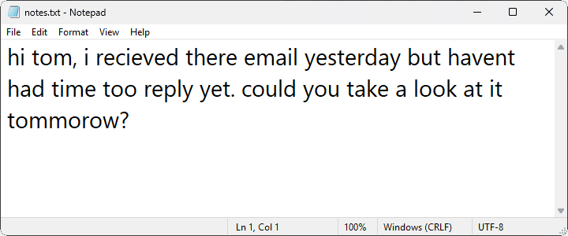
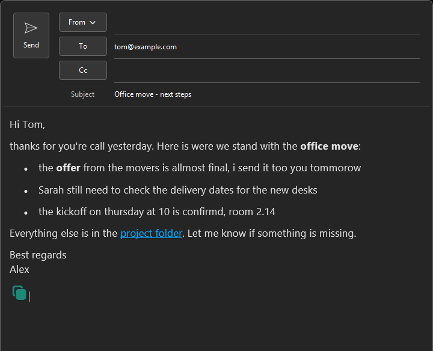
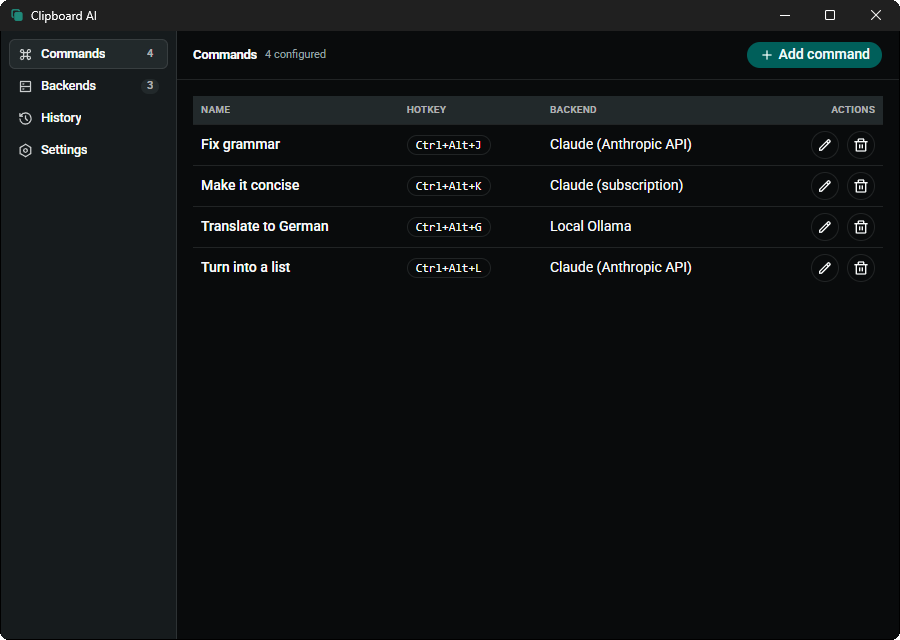

<p align="center">
  
</p>

<h1 align="center">Clipboard AI</h1>

<p align="center">Highlight text anywhere in Windows, press a hotkey, and an AI rewrites it in place.</p>

<p align="center">
  <a href="https://github.com/alexschnabl/clipboard-ai/releases/latest"></a>
  
  
  
</p>

<p align="center">
  
</p>

Clipboard AI sits in the tray. You set up **commands** - each one is a hotkey, a prompt, and a backend - and pressing a command's hotkey over any selected text sends that text to the AI and pastes the result back over your selection. That's the whole app. It ships with one command, "Fix grammar" on `Ctrl+Alt+J`.

What sets it apart from the other hotkey rewriters: it can run on the Claude subscription you already pay for (through the `claude` CLI, no API key), on any HTTP endpoint you own, or fully offline on a local model; it keeps bold, lists, tables, links and inline images through the rewrite; it refuses to paste when the result looks wrong; and it is a 15 MB Rust exe with a 4 MB installer.

Nothing about the text ever leaves your machine except the request to the backend you chose. Point a command at a local model and it stays fully offline.

## Contents

- [Install](#install)
- [Features](#features)
- [Backends](#backends)
- [Formatting](#formatting)
- [Use it](#use-it)
- [Configuration](#configuration)
- [Safety and privacy](#safety-and-privacy)
- [Languages](#languages)
- [Build from source](#build-from-source)
- [Develop](#develop)
- [FAQ](#faq)
- [License](#license)

## Install

Download the `-setup.exe` from the [latest release](https://github.com/alexschnabl/clipboard-ai/releases/latest) and run it. There is also an `.msi` if you prefer that, and a `SHA256SUMS.txt` to check either download against:

```powershell
Get-FileHash .\clipboard-ai-app_0.1.0_x64-setup.exe -Algorithm SHA256
```

The build is **unsigned**. Windows SmartScreen will warn you the first time you run the installer: click "More info", then "Run anyway". If you would rather not run an unsigned download, [build from source](#build-from-source) instead; it takes a few minutes and produces the same installer.

Built and tested on Windows 11, x64. Windows 10 should work but has not been tried. There is no auto-update yet, so a new version means a new download from the releases page.

Footprint, measured on the release build: the installer is 4 MB and the exe 15 MB. Idle, the app itself holds about 8 MB of private memory; the WebView2 processes that render the settings window add roughly 160 MB on top while the app runs.

## Features

- **Commands.** A command is a name, a hotkey, a prompt, and a backend. Add as many as you want. "Fix grammar" ships by default on `Ctrl+Alt+J`.
- **Works in any app.** The hotkey acts on whatever text is selected in the focused window - editor, browser, chat box, anywhere.
- **Keeps formatting.** Bold, lists, links, tables and inline images in the selection survive the round trip. Per command you can also ask for formatted output, or stick to plain text. See [Formatting](#formatting).
- **Four kinds of backend.** Local models, the Anthropic API, your Claude subscription through the `claude` CLI, or any HTTP endpoint you run. See [Backends](#backends).
- **Live settings.** Add or edit a backend or command and it applies straight away. No restart.
- **Run history.** The last 100 runs, input and output, so you can copy back a result you lost. Clear it any time.
- **It refuses to paste a bad result.** If the target window changed or the answer came back malformed, the command aborts instead of overwriting your text with a guess. See [Safety and privacy](#safety-and-privacy).
- **Five-language UI.** English, German, Spanish, French, Italian.

## Backends

A backend is where a command sends its text. You can mix them - one command on a local model, another on Claude.

| Backend | What it is | API key |
| --- | --- | --- |
| **OpenAI-compatible** | Any `/chat/completions` endpoint. Point it at a local [Ollama](https://ollama.com/) or [LM Studio](https://lmstudio.ai/), or at OpenAI itself. | Local: no. OpenAI: yes. |
| **Anthropic API** | The Anthropic Messages API. | Yes |
| **Claude CLI** | Your Claude subscription through the [`claude`](https://docs.claude.com/en/docs/claude-code) command. Requires the CLI installed and signed in. | No |
| **HTTP** | POSTs the selected text to a URL you choose - an n8n webhook, a local script, anything - and pastes whatever comes back. | Optional |

The HTTP backend sends the selected text as the raw request body (`text/plain`). If you set an API key it goes along as `Authorization: Bearer`. The response body is pasted back as-is - or turn off "Expect a response" and it just sends, pasting nothing. The command's prompt is not sent, so this one isn't an AI backend at all unless the endpoint you point it at is one.

## Formatting

When the selection carries formatting - it came from Outlook, Word, Gmail, Slack, a web page - the app sends the model a simplified HTML version of it, asks it to change only the words, and pastes the result back as rich text, with a plain-text copy for apps that only take text. Inline images never go to the model: they are swapped for short placeholders on the way out and put back in place on the way in.

<p align="center">
  
</p>

Each command has a Formatting setting:

- **Keep the selection's formatting** (default). Rich text is used only when there is something worth keeping: bold, italics, underline, links, lists, tables, headings or images. A plain selection and code copied from an editor go through as plain text, exactly as before.
- **Always return formatted text.** The model is asked to answer in HTML even for a plain selection. Use it for prompts like "turn these notes into a tidy list". A Markdown answer is converted too.
- **Plain text only.** Formatting and images are dropped; only the text is sent and pasted.

The HTTP backend always sends and receives plain text. Fonts and colours are kept for Office sources and dropped for browser sources, where they are computed-style noise. The model can still drop an image or restructure a list if the prompt asks for it; Ctrl+Z in the target app brings the original back.

## Use it

First launch puts an icon in the tray. Left-click it to open settings. Add a backend, add a command (a name, a hotkey, a prompt), and you're done. While a command runs the tray icon pulses and, after half a second, the mouse pointer turns into the Windows "working in background" arrow; both return to normal when the result lands.

The default flow:

1. Select some text in any app.
2. Press `Ctrl+Alt+J`.
3. The selection is replaced with the grammar-fixed version.

<p align="center">
  
</p>

## Configuration

You set everything up in the settings window; you don't need to hand-edit anything. Two things to configure:

- **Backends** - a type (OpenAI-compatible, Anthropic, Claude CLI, or HTTP), plus the endpoint, model, and key that type needs.
- **Commands** - a name, a global hotkey, a prompt, a formatting mode, and which backend to use.

Edits apply immediately. Config, keys, and history live under `%APPDATA%\com.clipboardai.app\` as a plain `config.json` (and a `history.json`), if you ever do want to look.

## Safety and privacy

Two things are worth understanding before you rely on this.

**A hotkey sometimes does nothing, on purpose.** If you switched windows, a modifier key was still held, or the model's answer came back malformed, Clipboard AI aborts instead of pasting a guess over your text. This is deliberate - it would rather do nothing than clobber your selection with the wrong thing. When a command aborts, the History tab tells you why.

**Your keys and history are stored in plain text** under `%APPDATA%\com.clipboardai.app\`. There's no encryption. Anyone with access to your user profile can read them. History keeps the last 100 runs - input and output - so you can copy back a result you lost; clear it any time from the History tab. The log file never contains your text.

If you want everything to stay on your machine, use a local backend (Ollama or LM Studio). Then no text is sent anywhere.

## Languages

The UI ships in English, German, Spanish, French, and Italian. Translations live in `src/lib/i18n/`. If you want to add or fix a language, a PR is welcome.

## Build from source

You need [Node](https://nodejs.org/), a [Rust toolchain](https://rustup.rs/), and on Windows the MSVC build tools ("Desktop development with C++", from the Visual Studio Installer).

```sh
npm install
npm run tauri build
```

The installers end up in `src-tauri/target/release/bundle/`: an NSIS `-setup.exe` under `nsis/` and an `.msi` under `msi/`. They are unsigned like the released ones, so SmartScreen warns here as well. Click "More info" then "Run anyway" if you trust what you built.

## Develop

```sh
npm run tauri dev
```

Tests: `cargo test` (from `src-tauri/`) and `npm run test`. The core loop - capture, send, paste, and the safety guards around it - lives in `src-tauri/src/cycle.rs`; the settings UI is SvelteKit under `src/`.

On Windows, `cargo` needs MSVC's `link.exe` on `PATH`. If a build can't find the linker, load `vcvars64.bat` from your Visual Studio install in the same shell first.

Windows only for now. Contributions and issues welcome.

## FAQ

**Why does nothing happen when I press the hotkey?**
Usually the safety guard kicked in - you switched windows, held a modifier too long, or the model returned something malformed. Check the History tab; it records the reason. Otherwise the hotkey might clash with another app's global shortcut, so try a different one in settings.

**The mouse pointer is stuck on the busy arrow.**
The pointer is swapped while a command runs and swapped back when it ends, even after an error. If the process was killed mid-run, start Clipboard AI again; it restores the pointer at launch. Or open Mouse Properties, Pointers tab, and click Apply.

**Why not just use PowerToys Advanced Paste?**
If OpenAI, Azure, Mistral, Google or Ollama is what you want and you don't mind working from the clipboard through a paste window, it is a fine choice, and it is signed by Microsoft. Clipboard AI is for what it doesn't cover: the Anthropic API, your Claude subscription, an HTTP endpoint of your own, and acting on the selection directly, with no window in between.

**What about Click to Do or Grammarly?**
Click to Do needs a Copilot+ PC, works on an OCR'd screenshot rather than your live selection, and you still paste the result by hand. Grammarly is cloud only, closed, and a subscription past its free tier. Both are fine if that is what you have; this is for people who want to pick their own model and keep the text where it is.

**Why Windows only?**
That's just where it's been built and tested. The stack (Tauri, Rust, Svelte) is cross-platform, but nothing else is done or verified yet.

**Why are my API keys in plain text?**
No secret storage is wired up yet. It's a known limitation - see [Safety and privacy](#safety-and-privacy). Use a local backend if you'd rather keep no keys at all.

**Why did my formatted text come back plain?**
With the default formatting mode the app only goes rich when there is something to keep - bold, links, lists, images and so on. Plain paragraphs and code from an editor are handled as plain text on purpose. Set the command to "Always return formatted text" if you want HTML back regardless.

**How do I use my Claude subscription without an API key?**
Install the `claude` CLI, sign in, then create a command with the Claude CLI backend. It calls the CLI on your behalf, so it uses your subscription instead of an API key.

## License

[MIT](LICENSE) - © 2026 Alexander Schnabl
