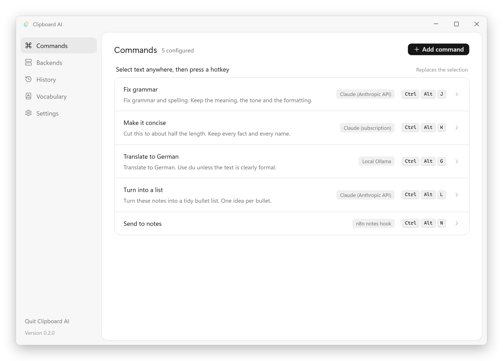
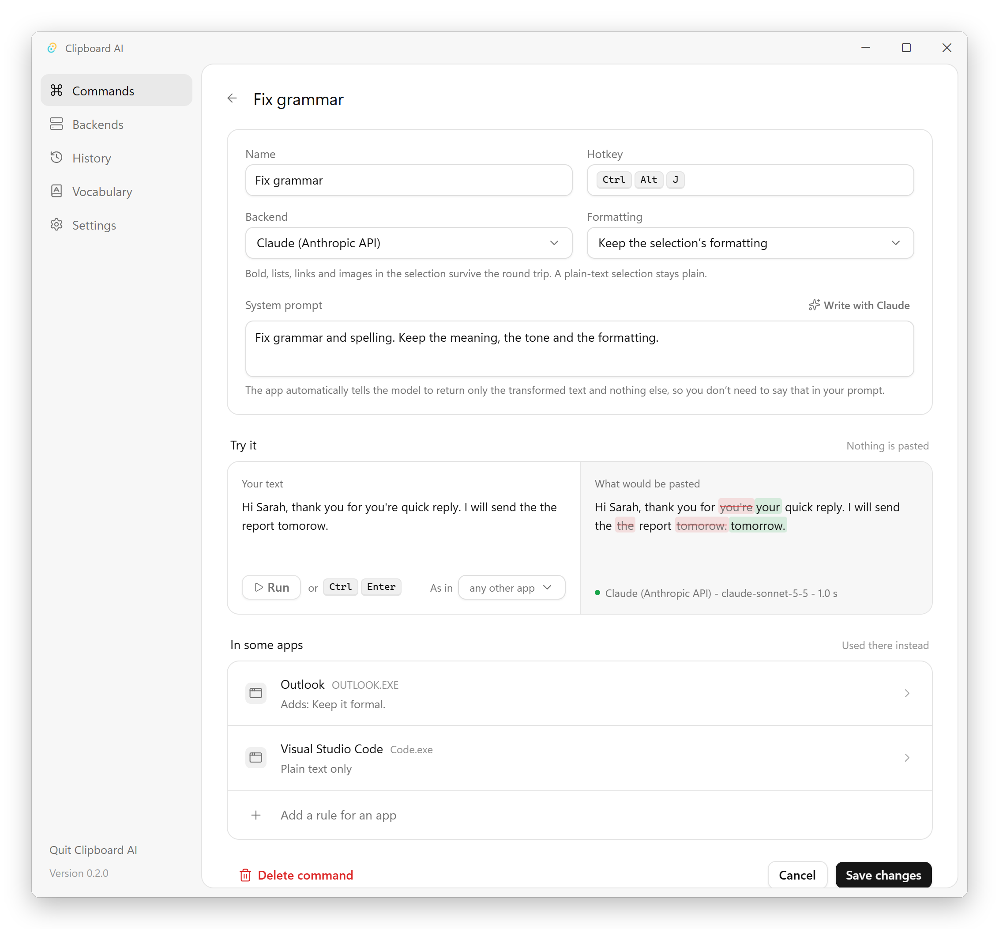
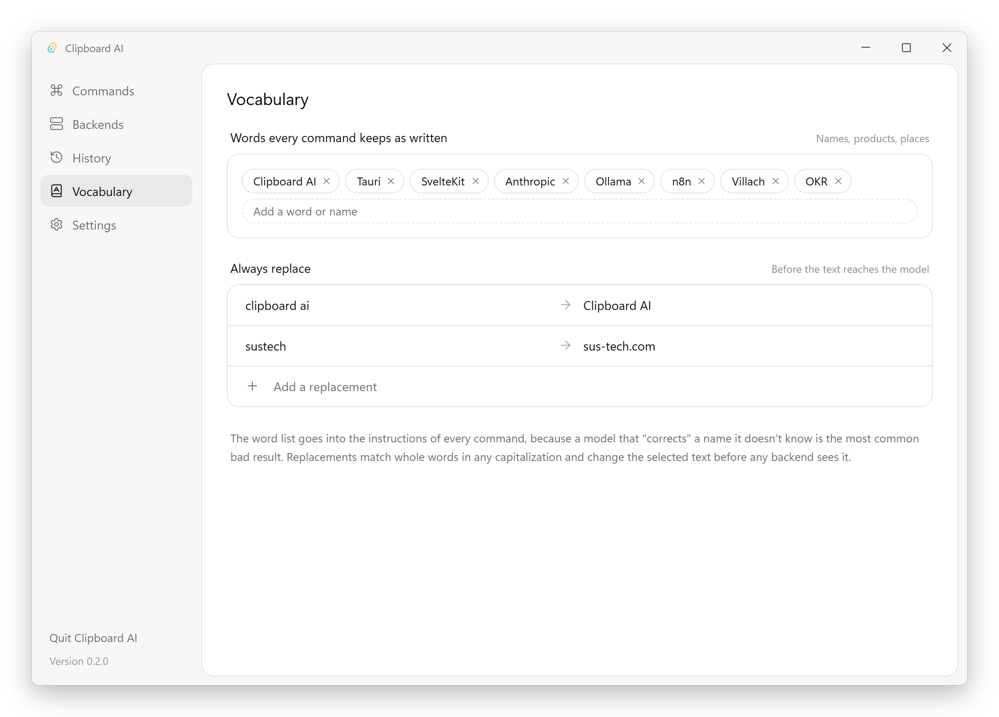
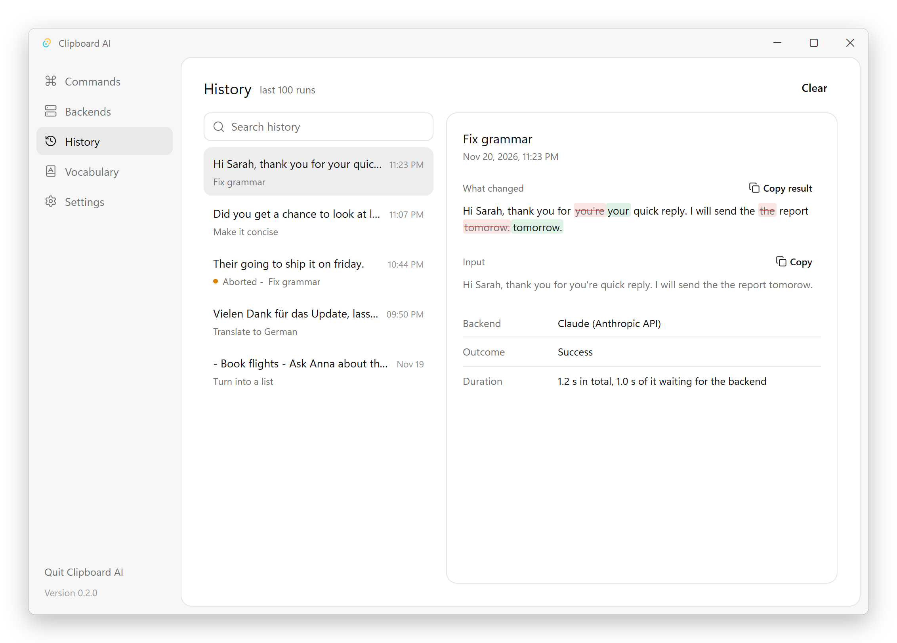

<p align="center">
  
</p>

<h1 align="center">Clipboard AI</h1>

<p align="center">Highlight text anywhere in Windows, press a hotkey, and an AI rewrites it in place.</p>

<p align="center">
  <a href="https://github.com/alexschnabl/clipboard-ai/releases/latest"></a>
  
  
  
</p>

<p align="center">
  
</p>

Clipboard AI sits in the tray. You set up **commands** - each one is a hotkey, a prompt, and a backend - and pressing a command's hotkey over any selected text sends that text to the AI and pastes the result back over your selection. It ships with one command, "Fix grammar" on `Ctrl+Alt+J`.

What sets it apart from the other hotkey rewriters: it can run on the Claude subscription you already pay for (through the `claude` CLI, no API key), on any HTTP endpoint you own, or fully offline on a local model; it keeps bold, lists, tables, links and inline images through the rewrite; it refuses to paste when the result looks wrong; and it is an 18 MB Rust exe with a 7 MB installer.

Nothing about the text ever leaves your machine except the request to the backend you chose. Point a command at a local model and it stays fully offline.

<p align="center">
  <picture>
    <source media="(prefers-color-scheme: dark)" srcset="assets/screenshot-commands-dark.png" />
    
  </picture>
</p>

## Contents

| Get started | How it works | More |
| --- | --- | --- |
| [Install](#install) | [History](#history) | [For developers](#for-developers) |
| [Features](#features) | [Backends](#backends) | [Build from source](#build-from-source) |
| [Use it](#use-it) | [Formatting](#formatting) | [FAQ](#faq) |
| [Writing commands](#writing-commands) | [Configuration](#configuration) | [License](#license) |
| [Vocabulary](#vocabulary) | [Safety and privacy](#safety-and-privacy) | |

## Install

Download the `-setup.exe` from the [latest release](https://github.com/alexschnabl/clipboard-ai/releases/latest) and run it. There is also an `.msi` if you prefer that, and a `SHA256SUMS.txt` to check either download against:

```powershell
Get-FileHash .\clipboard-ai-app_0.2.0_x64-setup.exe -Algorithm SHA256
```

The build is **unsigned**. Windows SmartScreen will warn you the first time you run the installer: click "More info", then "Run anyway". If you would rather not run an unsigned download, [build from source](#build-from-source) instead; it takes a few minutes and produces the same installer.

Built and tested on Windows 11, x64. Windows 10 should work but has not been tried.

Once a day the app looks for a new release on GitHub and, if there is one, offers it in a small prompt. Nothing installs until you click "Install and restart". You can also check by hand under Settings, About. Updates are signed, and the app refuses one whose signature doesn't match.

## Features

- **Commands.** A command is a name, a hotkey, a prompt, and a backend. Add as many as you want.
- **Works in any app.** The hotkey acts on whatever text is selected in the focused window - editor, browser, chat box, anywhere.
- **Status near the cursor.** A small capsule under your selection shows which command runs, lets you cancel with Esc, and tells you why nothing was pasted when a run stops. It never takes focus.
- **Command palette.** `Ctrl+Alt+Space` opens a list of every command next to the selection, plus a box for a one-off instruction like "make it friendlier".
- **Try it before you use it.** The command editor runs a sample through the backend and shows what would be pasted, word by word.
- **Write with AI.** Describe a command in plain words and a backend writes the prompt for you. With a Claude backend the button says "Write with Claude".
- **Rules per app.** The same hotkey can be formal in Outlook and plain text in VS Code.
- **Vocabulary.** Names the model must not "correct", and replacements that run before the text reaches it.
- **Keeps formatting.** Bold, lists, links, tables and inline images survive the round trip. See [Formatting](#formatting).
- **Four kinds of backend.** Local models, the Anthropic API, your Claude subscription through the `claude` CLI, or any HTTP endpoint you run. See [Backends](#backends).
- **Backend checks.** One click tells you whether each backend answers, and how fast.
- **History.** The last 100 runs with what changed, searchable, so you can copy back a result you lost.
- **Paste again.** Lost a result? Paste the last one again from the tray, or with a hotkey you turn on.
- **Keys in Credential Manager.** API keys are stored by Windows, not in a config file.
- **It refuses to paste a bad result.** If the target window changed or the answer came back malformed, the command stops instead of overwriting your text with a guess.
- **Light and dark, five languages.** Follows Windows, in English, German, Spanish, French and Italian.

## Use it

First launch puts an icon in the tray. Left-click it to open the settings window. A short "Get started" card walks you through it: set up a backend, check that it answers, then try "Fix grammar".

The default flow:

1. Select some text in any app.
2. Press `Ctrl+Alt+J`.
3. A small capsule appears under the selection while the backend works. Press Esc to cancel.
4. The selection is replaced, and the capsule says how many words changed. `Ctrl+Z` in the app brings the original back.

**Command palette.** Don't want to remember every hotkey? Select text and press `Ctrl+Alt+Space`. Type to filter your commands, or type an instruction of your own and press Enter. Tab picks which backend runs a typed instruction. The result goes back into the app you came from.

**Paste the last result again.** If a result landed in the wrong place, click "Paste last result" in the tray menu. You can also turn on a hotkey for it under Settings, Shortcuts that work everywhere. It is off by default because Office uses `Ctrl+Alt+V` for Paste Special.

The palette, the paste-again hotkey, the status capsule and the busy pointer can all be changed or turned off in Settings.

## Writing commands

Click a command to open it. Besides the name, hotkey, backend and prompt, the editor has three helpers.

<p align="center">
  
</p>

- **Try it.** Paste a sample, press Run, and see exactly what would be pasted, with every changed word marked. It runs the command as you have it in the editor, including unsaved changes, your vocabulary and, if you pick one, an app's rule. Nothing is pasted anywhere.
- **Write with AI.** Describe what the command should do, like "make my emails friendlier but keep them short", and a backend writes the prompt into the editor. You can edit it or undo it.
- **In some apps.** Add a rule for an app and the command changes there: an extra line for the prompt, a different backend, or a different formatting mode. Pick the app from the ones running right now, or type its program name, like `OUTLOOK.EXE`. The app is the one in front when you press the hotkey.

## Vocabulary

<p align="center">
  
</p>

Two lists that apply to every command:

- **Words every command keeps as written.** Names, products and places go into the instructions of every run, because a model that "corrects" a name it doesn't know is the most common bad result.
- **Always replace.** Pairs like `sustech` to `sus-tech.com` change the selected text before any backend sees it. They match whole words in any capitalization, and formatting is left alone.

## History

<p align="center">
  
</p>

The last 100 runs, newest first. Search finds a run by its text, command or backend. Each run shows what changed, the original input, the backend and where the time went, with buttons to copy either side. A run that stopped says why in plain words. Clear it any time.

## Backends

A backend is where a command sends its text. You can mix them - one command on a local model, another on Claude.

| Backend | What it is | API key |
| --- | --- | --- |
| **OpenAI-compatible** | Any `/chat/completions` endpoint. Point it at a local [Ollama](https://ollama.com/) or [LM Studio](https://lmstudio.ai/), or at OpenAI itself. | Local: no. OpenAI: yes. |
| **Anthropic API** | The Anthropic Messages API. | Yes |
| **Claude CLI** | Your Claude subscription through the [`claude`](https://docs.claude.com/en/docs/claude-code) command. Requires the CLI installed and signed in. | No |
| **HTTP** | POSTs the selected text to a URL you choose - an n8n webhook, a local script, anything - and pastes whatever comes back. | Optional |

The HTTP backend sends the selected text as the raw request body (`text/plain`). If you set an API key it goes along as `Authorization: Bearer`. The response body is pasted back as-is - or turn off "Expect a response" and it just sends, pasting nothing. The command's prompt is not sent, so this one isn't an AI backend at all unless the endpoint you point it at is one.

On the Backends page, "Check" sends a tiny test request and tells you in one line how it went: how long it took, a rejected key, a model that was cold, or a server that isn't there. For the Claude CLI it only asks the CLI for its version and sign-in status. For an HTTP backend it only opens a connection and sends nothing, so your webhook never fires from a check.

## Formatting

When the selection carries formatting - it came from Outlook, Word, Gmail, Slack, a web page - the app sends the model a simplified HTML version of it, asks it to change only the words, and pastes the result back as rich text, with a plain-text copy for apps that only take text. Inline images never go to the model: they are swapped for short placeholders on the way out and put back in place on the way in.

<p align="center">
  
</p>

Each command has a Formatting setting:

- **Keep the selection's formatting** (default). Rich text is used only when there is something worth keeping: bold, italics, underline, links, lists, tables, headings or images. A plain selection and code copied from an editor go through as plain text.
- **Always return formatted text.** The model is asked to answer in HTML even for a plain selection. Use it for prompts like "turn these notes into a tidy list". A Markdown answer is converted too.
- **Plain text only.** Formatting and images are dropped; only the text is sent and pasted.

The HTTP backend always sends and receives plain text. Fonts and colours are kept for Office sources and dropped for browser sources, where they are computed-style noise.

## Configuration

You set everything up in the settings window; you don't need to hand-edit anything. Edits apply immediately, with no restart.

Config and history live under `%APPDATA%\com.clipboardai.app\` as a plain `config.json` and `history.json`, if you ever want to look. API keys are not in there - see [Safety and privacy](#safety-and-privacy).

## Safety and privacy

**A hotkey sometimes does nothing, on purpose.** If you switched windows, a modifier key was still held, or the model's answer came back malformed, Clipboard AI stops instead of pasting a guess over your text. The status capsule tells you why on the spot, and the History page keeps the reason.

**API keys live in Windows Credential Manager**, one entry per backend, named `clipboard-ai:backend:<id>`. You can see them under Control Panel, Credential Manager, Windows Credentials. They are tied to your Windows account and not written to `config.json`. Anything running as you can still read them, so this protects against copied or synced config files, not against malware on your account. Older versions kept keys in `config.json`; the first start of this version moves them over, checks each one reads back correctly, and only then removes it from the file. If Credential Manager refuses, the key stays where it was and the settings window tells you.

**History and the local API token are stored in plain text** under `%APPDATA%\com.clipboardai.app\`. History keeps the last 100 runs - input and output - so you can copy back a result you lost; clear it any time from the History page. The log file never contains your text or your keys.

If you want everything to stay on your machine, use a local backend (Ollama or LM Studio). Then no text is sent anywhere.

## For developers

### Command line

The installer puts a `clipboard-ai` command on your Path (new terminals only). It runs your commands on text from stdin and prints the result, with your vocabulary. It reads the same config as the app, never changes it, and works whether or not the app is running.

```powershell
Get-Content notes.txt | clipboard-ai run "Fix grammar"
clipboard-ai run fix-grammar --text "teh quick fox" --json
clipboard-ai run --prompt "Translate to German" --backend "Local Ollama" --text "Good morning"
clipboard-ai list
clipboard-ai history --limit 5
```

- `run <command>` takes a command name or id. `--backend` swaps the backend, `--prompt` replaces the command's prompt for this run.
- Results go to stdout, errors to stderr. `--json` prints one JSON object instead, `--html` prints HTML when the command returned formatted text.
- Exit codes: `0` success, `1` the backend failed, `2` wrong usage or unusable input, `3` config problem or unknown command.
- `clipboard-ai --help` shows all options. Runs from the command line are not added to the history, and no app rule applies.

Windows PowerShell 5.1 pipes text to programs as ASCII by default, so accented letters arrive as `?`. Run this once per session, or put it in your profile:

```powershell
$OutputEncoding = [Console]::InputEncoding = [Console]::OutputEncoding = [Text.UTF8Encoding]::new()
```

### Local API

Off by default. Turn it on under Settings, Developers, Local API. The app then listens on `127.0.0.1` only, on a free port or one you set, and shows the address and a token. Every request needs the token as `Authorization: Bearer <token>`.

| Method | Path | What it does |
| --- | --- | --- |
| `GET` | `/v1/health` | Returns `{"ok":true,"version":"..."}` |
| `GET` | `/v1/commands` | Lists commands and backends, without keys or URLs |
| `POST` | `/v1/run` | Runs text through a command and returns the result |

```powershell
$api = Get-Content "$env:APPDATA\com.clipboardai.app\local-api.json" | ConvertFrom-Json
$body = @{ command = "Fix grammar"; text = "teh quick fox" } | ConvertTo-Json
Invoke-RestMethod "$($api.url)/v1/run" -Method Post -ContentType "application/json" -Headers @{ Authorization = "Bearer $($api.token)" } -Body $body
```

The run body takes `text` and either `command` (name or id) or `prompt`, plus an optional `backend`. The answer has `text`, `html` (or `null`), `command`, `backend` and `backendMs`. Errors come back as `{"ok":false,"error":{"code":"...","message":"..."}}` with a matching HTTP status.

- Limits: 256 KB request body, 100,000 characters of text, 4 runs at a time.
- Requests from web pages (anything with an `Origin` or `Sec-Fetch-*` header) and requests not addressed to `127.0.0.1` or `localhost` are refused. There is no CORS.
- Check that the app is running before you send the token: while it is closed, another program could take a fixed port. Regenerate the token in Settings if it leaks.

## Build from source

You need [Node](https://nodejs.org/), a [Rust toolchain](https://rustup.rs/), and on Windows the MSVC build tools ("Desktop development with C++", from the Visual Studio Installer).

```sh
npm install
npm run tauri build
```

The installers end up in `src-tauri/target/release/bundle/`: an NSIS `-setup.exe` under `nsis/` and an `.msi` under `msi/`. They are unsigned like the released ones, so SmartScreen warns here as well.

For development, `npm run tauri dev` runs the app with live reload. Tests: `cargo test` (from `src-tauri/`) and `npm run test`. The core loop - capture, send, paste, and the safety guards around it - lives in `src-tauri/src/cycle.rs`; the settings window is SvelteKit under `src/`. If `cargo` can't find the linker, load `vcvars64.bat` from your Visual Studio install in the same shell first.

### Release checklist

For maintainers. A release needs an update signature, or installed copies won't take it. Two values, kept out of the repo:

- `TAURI_SIGNING_PRIVATE_KEY` - the updater private key (the file's contents, or its path). Its public half is `plugins.updater.pubkey` in `src-tauri/tauri.conf.json`.
- `TAURI_SIGNING_PRIVATE_KEY_PASSWORD` - the key's password. For a key without one, leave it unset; the build then asks for the password and Enter is the answer.

Losing the private key means installed copies can't update any more, so keep a backup.

1. Bump the version in `package.json`, `src-tauri/tauri.conf.json` and `src-tauri/Cargo.toml`.
2. Build with updater artifacts: `npm run tauri build -- --config src-tauri/tauri.updater.conf.json`. This writes a `.sig` next to the `-setup.exe`.
3. Run `node scripts/latest-json.mjs --notes "What changed"` to write `latest.json` next to the installer.
4. Create the GitHub release `v<version>` and upload the `-setup.exe`, the `.msi`, `SHA256SUMS.txt` and `latest.json`. The app reads `releases/latest/download/latest.json`, so the release must be marked as latest.

Contributions and issues welcome - see [CONTRIBUTING.md](CONTRIBUTING.md).

## FAQ

**Why does nothing happen when I press the hotkey?**
Usually the safety guard kicked in - you switched windows, held a modifier too long, or the model returned something malformed. The status capsule and the History page say why. Otherwise the hotkey might clash with another app's global shortcut; the Commands page marks clashes it can see, so try a different one.

**The mouse pointer is stuck on the busy arrow.**
The pointer is swapped while a command runs and swapped back when it ends, even after an error. If the process was killed mid-run, start Clipboard AI again; it restores the pointer at launch. Or open Mouse Properties, Pointers tab, and click Apply. You can also turn the busy pointer off in Settings.

**Why not just use PowerToys Advanced Paste?**
If OpenAI, Azure, Mistral, Google or Ollama is what you want and you don't mind working from the clipboard through a paste window, it is a fine choice, and it is signed by Microsoft. Clipboard AI is for what it doesn't cover: the Anthropic API, your Claude subscription, an HTTP endpoint of your own, and acting on the selection directly, with no window in between.

**What about Click to Do or Grammarly?**
Click to Do needs a Copilot+ PC, works on an OCR'd screenshot rather than your live selection, and you still paste the result by hand. Grammarly is cloud only, closed, and a subscription past its free tier. Both are fine if that is what you have; this is for people who want to pick their own model and keep the text where it is.

**Why Windows only?**
That's just where it's been built and tested. The stack (Tauri, Rust, Svelte) is cross-platform, but nothing else is done or verified yet.

**Where are my API keys stored?**
In Windows Credential Manager, not in `config.json`. Each backend gets one entry named `clipboard-ai:backend:<id>`. Deleting a backend deletes its entry. In the backend editor the key field stays empty; click the eye to show the stored key.

**A backend check says "Key rejected" or "Not reachable".**
"Key rejected" means the service answered and refused the key - paste a fresh one. "Not reachable" means nothing answered at that address: for Ollama or LM Studio, start it first. "Model was cold" is fine - a local model loads into memory on its first request, and the next one is fast.

**Why did my formatted text come back plain?**
With the default formatting mode the app only goes rich when there is something to keep - bold, links, lists, images and so on. Plain paragraphs and code from an editor are handled as plain text on purpose. Set the command to "Always return formatted text" if you want HTML back regardless.

**How do I use my Claude subscription without an API key?**
Install the `claude` CLI, sign in, then create a backend of the Claude CLI kind and point a command at it. It calls the CLI on your behalf, so it uses your subscription instead of an API key.

## License

[MIT](LICENSE) - © 2026 Alexander Schnabl
