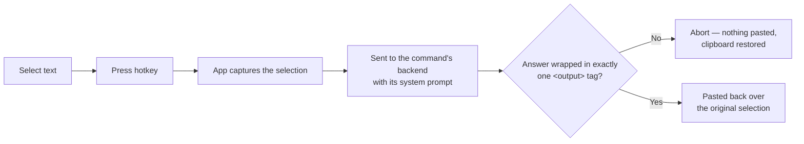

# Clipboard AI

Select text in any Windows application, press a hotkey, and get it transformed by an AI
backend — pasted back in place, over your original selection.

<!-- SCREENSHOT: hero — animated GIF of the select -> hotkey -> result loop in Notepad -->
*[Animated GIF: selecting a sentence in Notepad, pressing the "Fix grammar" hotkey, the
cursor-following indicator appearing briefly, and the corrected text landing over the
selection.]*

## How it works

You select some text and press a hotkey bound to one of your configured **commands**. The
app copies the selection, sends it to that command's **backend** together with its system
prompt, and — if the backend's answer comes back wrapped in exactly one `<output>` tag —
pastes the result back over the selection. Anything less certain than that (no tag, two
tags, a window switch, a stuck modifier key) aborts instead of pasting a guess; see
[The safety model](#the-safety-model).



No window steals focus in the normal case — the whole interaction happens without leaving
the application you're typing in. The app is tray-resident; nothing is visible until you
open its settings from the tray icon.

## Features

- **Commands**: name + hotkey + system prompt + backend, any number of them, each bound to
  its own global hotkey.
- **Three backend kinds**: an OpenAI-compatible `/chat/completions` endpoint (a local Ollama
  or LM Studio server, or OpenAI itself), the Anthropic Messages API directly with your own
  API key, or the `claude` CLI using your existing Claude subscription (no API key needed).
- **Live hotkey re-registration**: editing a command in Settings takes effect immediately —
  no restart.
- **Run history**: the last 100 runs, each with the captured input and pasted result,
  viewable and copyable from the History tab, clearable at any time.
- **Settings**: theme (system/light/dark), five UI languages (English, German, French,
  Spanish, Italian, or follow the OS), and launch-on-sign-in.
- **A cursor-following indicator** appears while a cycle is running, escalates after ~2.5s
  if a backend is slow to answer, and flashes distinctly on a real failure versus a
  deliberate abort.
- **Corrupt config.json is preserved, not overwritten** — an unreadable config file is moved
  aside (`config.json.corrupt`) rather than silently replaced with an empty one.
- **Abort rather than guess**: clipboard, window focus and modifier-key state are all
  rechecked immediately before anything is pasted.

## Installation

There are no packaged releases yet — building from source is the only path today.

**Requirements:**
- [Node.js](https://nodejs.org/) and npm
- A [Rust toolchain](https://rustup.rs/)
- On Windows, the MSVC build tools (Visual Studio Build Tools with the "Desktop development
  with C++" workload) — `cargo` needs `link.exe` on `PATH`. See
  [Development](#development) below if `cargo build`/`cargo test` can't find it.

```sh
npm install
npm run tauri build
```

This runs the frontend build, then `cargo build`, and produces a release bundle under
`src-tauri/target/release/` (see `bundle` in `src-tauri/tauri.conf.json` for the configured
targets).

## Setup

**First run.** Launching the built app creates a default `config.json` and puts an icon in
the system tray — no window opens on its own. Left-click the tray icon, or use its
"Settings" menu entry, to open the settings window.

<!-- SCREENSHOT: tray icon and its context menu -->
*[Screenshot: the tray icon with its right-click menu open, showing the status line,
Settings, the configured commands, "Open config file", "Reload config", "Show log", and
Quit.]*

**Adding a backend.** Go to the Backends tab, "Add backend", and pick a kind:

- **OpenAI-compatible** — a base URL and a model name, both required. For a local Ollama
  install, the shipped default is a concrete example: base URL
  `http://localhost:11434/v1`, model `qwen2.5:32b-instruct`. An API key is optional (local
  servers usually don't need one).
- **Anthropic API** — requires an API key (`x-api-key`); the model field is optional and
  falls back to a built-in default if left blank.
- **Claude CLI** — no base URL, model or API key: it shells out to a `claude` executable on
  `PATH` and uses that CLI's own subscription login. Nothing to configure beyond a name and
  a timeout.

<!-- SCREENSHOT: Add backend dialog, kind = OpenAI-compatible, filled in with the Ollama example -->
*[Screenshot: the "Add backend" dialog with Name "Local Ollama", Kind "OpenAI-compatible",
Base URL `http://localhost:11434/v1`, Model `qwen2.5:32b-instruct`.]*

**Adding a command.** Go to the Commands tab, "Add command", give it a name, pick a
backend, and write a system prompt (e.g. "Fix grammar and spelling. Keep the meaning.").
The app ships with one command out of the box — "Fix grammar", bound to `Ctrl+Alt+J`
against the local Ollama backend above.

<!-- SCREENSHOT: Commands tab with two or three configured commands -->
*[Screenshot: the Commands tab listing "Fix grammar" (Ctrl+Alt+J, Local Ollama) plus one or
two more example commands.]*

**Recording a hotkey.** Click the hotkey field in the command form and press a combination.
It needs at least one modifier (Ctrl, Alt, Shift or Win) plus a key — a bare key is
rejected, since it would swallow that key system-wide. Recording is keyboard-layout
independent (it reads the physical key, not the character it produces) and briefly
suspends the app's other hotkeys so it can't accidentally trigger one while you're setting
another. Press Escape to cancel.

## Configuration

Everything lives in `%APPDATA%\com.clipboardai.app\config.json`, created with defaults on
first run. Hand-editing it is a supported path — the same validation that guards the
settings UI runs again on load — and the file carries a schema `version` (currently `2`)
that's migrated automatically and silently on an older file (logged once, not shown as a
prompt). If the file fails to parse, it's moved aside as `config.json.corrupt` (or
`.corrupt.2`, and so on) instead of being overwritten, and the settings window tells you
where it went.

Two files live alongside it, in the same directory:

- **`history.json`** — the last 100 runs.
- **`clipboard-ai.log`** — one line per hotkey press (`PASTED`/`ABORTED`, a reason, and
  timings), truncated once it passes about 1 MB.

**Read this before you configure a real backend:**

- **API keys are stored in plaintext** in `config.json`. There is no OS keychain
  integration. Anyone who can read that file can read your keys.
- **History stores what you selected and what came back, in plaintext**, in `history.json`
  — that's the point of a history you can open and read, not an oversight. Each of the two
  text fields is truncated at 4,000 characters (with a visible marker when it happens), and
  the file holds at most the 100 most recent runs; older entries are evicted. If you run a
  command over something sensitive, it stays on disk until it rolls out of that 100-entry
  window — or until you clear it from the History tab, which is immediate.
- `clipboard-ai.log`, by contrast, deliberately never contains clipboard text — only
  timings, outcome reasons, and backend error messages.

## The safety model

This is the app's defining property: it types into other applications' windows and
overwrites your real selection, so every stage is built to **abort rather than paste**
whenever anything is uncertain. A failed check produces nothing on screen — never a guess.
This is why a hotkey press sometimes visibly does nothing: something it checked came back
uncertain, and it declined rather than risk pasting the wrong thing into your document.
Check the History tab (an "Aborted" or "Failed" entry names the reason) or the log file if
you want to know why.

- **Your clipboard is always restored.** A guard armed at the very start of every cycle
  restores whatever was on the clipboard before, on every exit path — an early return, or
  even a panic — with no "disarm" step for any code path to forget.
- **Focus and held-down modifier keys are rechecked immediately before pasting.** If you
  switched windows, or the hotkey's own modifier keys are still physically held down (the
  OS hasn't finished releasing the chord yet), the cycle aborts instead of pasting into
  whatever now has focus or leaking a stuck chord into it.
- **The model's answer has to be unambiguous.** Every system prompt is silently wrapped
  with an instruction to answer inside `<output>...</output>` tags. If those tags are
  missing, or if more than one complete `<output>...</output>` block shows up (which can
  mean the model echoed the instruction back, or gave two candidate answers), nothing is
  pasted — refusal, never empty text and never a guess at which block is the real one.
- **Abort is not failure.** Every abort carries its own reason
  (`modifiers-stuck`, `focus-changed`, `capture-timeout`, `no-sentinel`, `empty-result`,
  `modifiers-stuck-before-paste`, `clipboard-write-failed`, `paste-failed`, or a real
  `backend-error` with the underlying cause attached) and is logged. History records it as
  "Aborted", kept distinct from a "Failed" run (an actual backend error) and a "Success" — a
  cycle that correctly declined to touch your document is not a bug to fix.

<!-- SCREENSHOT: History tab with an expanded row showing an Aborted entry next to a Success -->
*[Screenshot: the History tab, one row expanded to show its captured input/result, with at
least one "Aborted" and one "Success" entry visible in the list for contrast.]*

For contributors: this all lives mainly in `src-tauri/src/cycle.rs` (the capture → transform
→ paste engine and its guards), `src-tauri/src/osops.rs` (the Win32 clipboard/focus/modifier
reads, behind the `OsOps` trait so `cycle.rs` can be tested against a fake), and
`src-tauri/src/sentinel.rs` (the `<output>` wrap/extract contract). The cursor-following
indicator (`src-tauri/src/overlay.rs`) follows the identical guard-plus-`Drop` shape as the
clipboard guard, for the same reason: "stop showing" has to be a property of scope, not a
step any one exit path can forget.

## Architecture

**Rust (`src-tauri/src/`)**

| Module | Responsibility |
|---|---|
| `lib.rs` | App wiring: `AppState`, the global-shortcut dispatch closure, the tray icon/menu, the settings window's show/hide lifecycle. |
| `config.rs` | The config schema (v2), parsing, validation, v1→v2 migration, atomic load/save, corrupt-file preservation. |
| `commands.rs` | The Tauri IPC commands the settings window calls (`get_config`, `save_config`, `suspend_hotkeys`, `resume_hotkeys`, `get_history`, `clear_history`). |
| `cycle.rs` | The capture → transform → paste engine — one hotkey press, end to end. |
| `hotkeys.rs` | Turns a `Config` into OS-registered global shortcuts, and registration failures into `Problem`s the UI can show. |
| `sentinel.rs` | The `<output>` wrap/extract contract. |
| `osops.rs` | The `OsOps` trait plus its Windows implementation: clipboard, synthetic copy/paste, focus and modifier-key reads. |
| `history.rs` | The last-100-runs store (`history.json`). |
| `status.rs` | Log-line formatting and log file writes. |
| `overlay.rs` | The cursor-following in-flight indicator window. |
| `settings.rs` | Applies persisted settings that reach outside the process (currently just autostart). |
| `backend/` | The `Backend` trait plus one adapter each for `openai.rs`, `anthropic.rs`, `claude_cli.rs`. |

**Frontend (`src/`)** — SvelteKit + Svelte 5 + shadcn-svelte + Tailwind, prerendered to
static HTML (`adapter-static`) and loaded into the settings window; Tauri has no Node
server at runtime.

| Path | Responsibility |
|---|---|
| `routes/+page.svelte` | The settings window shell: sidebar navigation over Commands, Backends, History and Settings. |
| `routes/overlay/` | The in-flight indicator's own tiny page, driven purely by the `overlay://state` event stream. |
| `lib/components/` | Hand-written UI: `CommandList`/`CommandForm`, `BackendList`/`BackendForm`, `HotkeyRecorder`, `HistoryPanel`, `SettingsPanel`, `SettingsSidebar`. |
| `lib/components/shadcn/` | Generated shadcn-svelte primitives — regenerate via the shadcn CLI, don't hand-edit. |
| `lib/state/config.svelte.ts` | The single reactive source of truth for config and history: load, immediate-commit-with-rollback edits, history load/clear. |
| `lib/i18n/` | The dictionary-based i18n store and its five language files, plus `registry.ts` as the single source of which languages exist. |
| `lib/hotkey.ts` | Converts a browser `KeyboardEvent` into the shortcut spelling Rust's hotkey parser expects. |

`docs/superpowers/` holds the project's design history — a spike → v1 → v2 trail of specs
(`specs/`), plans (`plans/`) and verification notes (`notes/`), each building on and partly
superseding the last. Read it for *why* something is built the way it is; read this file
and the code for what it *is* today.

## Development

```sh
npm install
npm run tauri dev   # full app: Rust backend, tray icon, live hotkeys, settings window
```

`npm run dev` alone only starts the Vite dev server for the settings UI in a browser — no
tray, no hotkeys, no Rust backend behind it.

**Testing:**

- Rust — from `src-tauri/`: `cargo test` (163 tests).
- Frontend — `npm run test` (Vitest, 113 tests across `test/unit/`).
- `npm run check` — `svelte-kit sync` + `svelte-check` across the frontend.

**Windows/MSVC gotcha:** `cargo` needs MSVC's `link.exe` on `PATH`. If `cargo build`/`cargo
test` fails to find it, load `vcvars64.bat` from your Visual Studio install in the *same*
shell invocation before running cargo, e.g. from PowerShell:

```
cmd /c '"<path to VS>\VC\Auxiliary\Build\vcvars64.bat" >nul && cd /d <repo>\src-tauri && cargo test'
```

**Contributing:** there's no CI configured yet. Before submitting a change, run both test
suites and `npm run check` above.

## Platform support

Windows is the only supported platform today. Hotkey capture, clipboard access, and the
focus/modifier checks the safety model depends on (`osops.rs`) call the Win32 API directly
(`GetForegroundWindow`, `GetAsyncKeyState`) alongside `arboard`/`enigo`. macOS and Linux are
not implemented — `docs/superpowers/` has some early thinking about what a cross-platform
port would need, but there's no code toward it yet.

## License

TODO(license): no license has been chosen for this project yet.
